# Alma Android

[简体中文](README.zh-CN.md)

> 🛠️ **Built with Alma, end to end.** This whole project is developed and managed through [Alma](https://alma.now): planning, code, tests, screenshots, releases and this README were produced by Alma and its agent crew, while a human steers and tests on real devices. An Alma client, made by Alma.

An unofficial Android client for [Alma Desktop](https://alma.now). Pair it with one or more desktops and keep working with your threads from an Android phone or foldable.

> **Disclaimer:** This project is not affiliated with, endorsed by, or maintained by the Alma project.

## Screenshots

| Threads and the floating tab bar                                                                 | Alma                                                                                                   |
| ------------------------------------------------------------------------------------------------ | ------------------------------------------------------------------------------------------------------ |
| 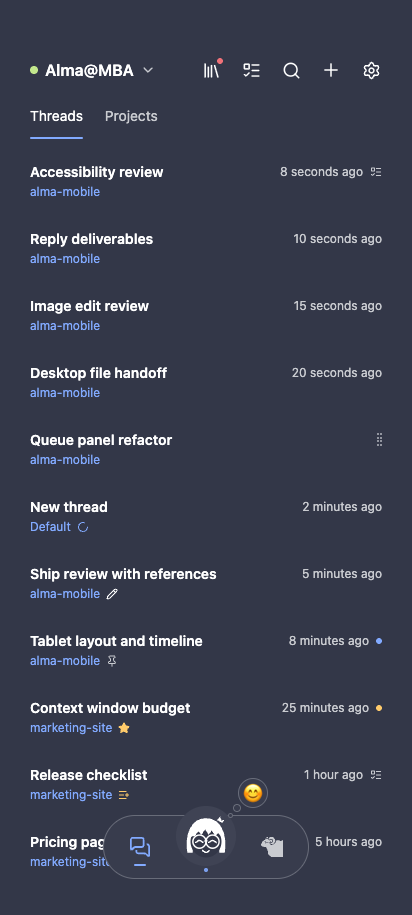 | 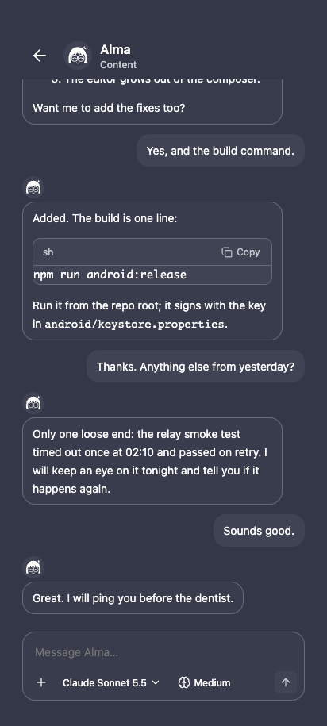                          |
| Conversation                                                                                     | Long-press preview and actions                                                                         |
| 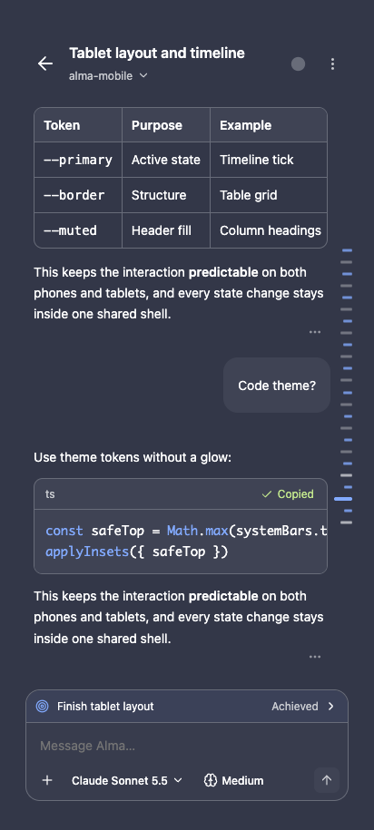                              | 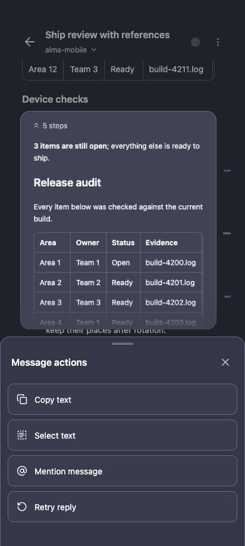 |
| Files and diffs                                                                                  | Settings (简体中文)                                                                                    |
| 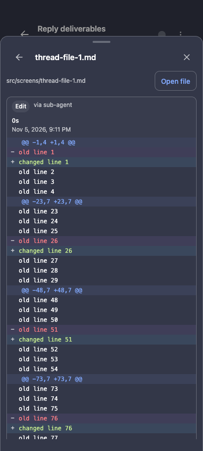                                        | 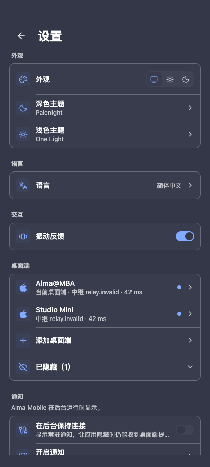                                    |

### Herdr agents, remote desktop and updates

| Herdr sessions                                                                | Answer an agent's menu                                                             |
| ----------------------------------------------------------------------------- | ---------------------------------------------------------------------------------- |
| 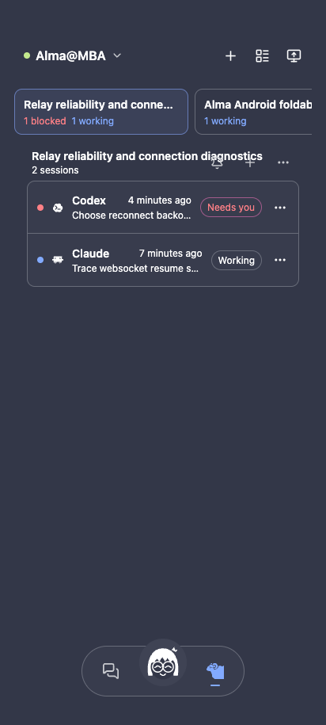   | 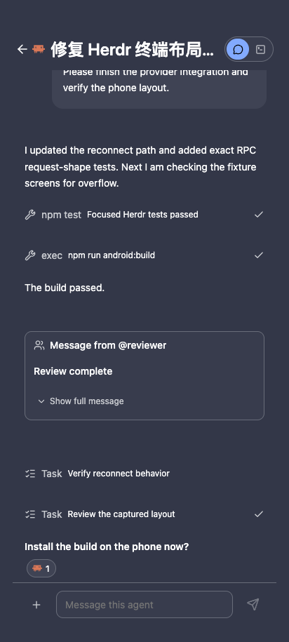      |
| Remote desktop, trackpad control at 1:1                                       | Choose a display or window                                                         |
| 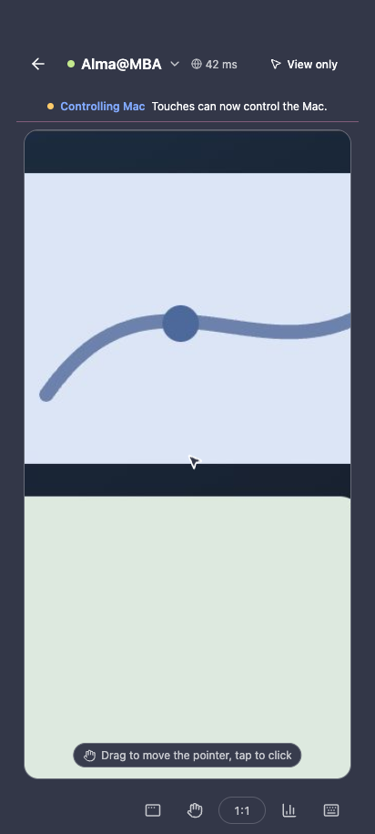 | 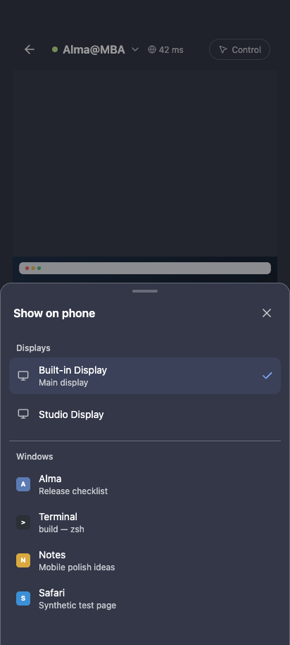 |
| In-app updates                                                                |                                                                                    |
| 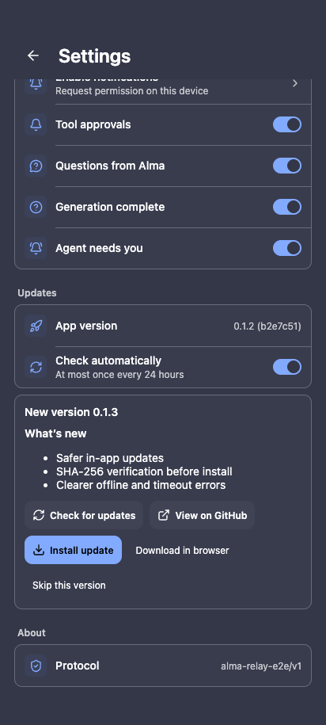              |                                                                                    |

### Foldables

Unfolded, the app switches to a two-pane layout with a navigation rail, the thread list and the open conversation side by side; the thread list can be collapsed to give the conversation the full width. Alma's face sits in the rail's top corner; opening her takes everything right of the rail, with her face docked across the rail edge. Folding and unfolding plays a frosted transition between the cover and inner screens.

| Alma, docked on the rail                                                                           | Unfolded, thread list collapsed                                                                                            |
| -------------------------------------------------------------------------------------------------- | -------------------------------------------------------------------------------------------------------------------------- |
| 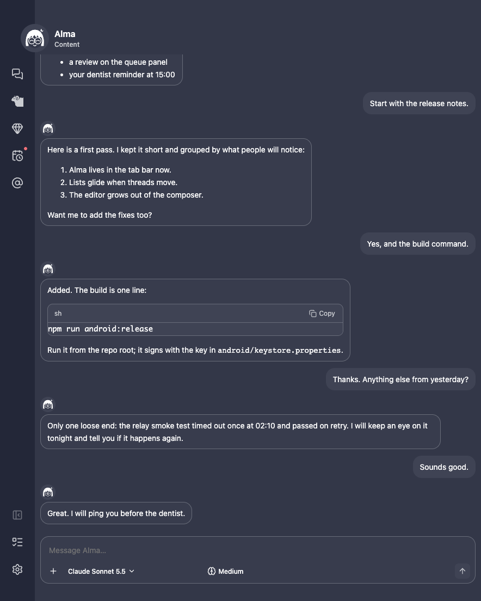    | 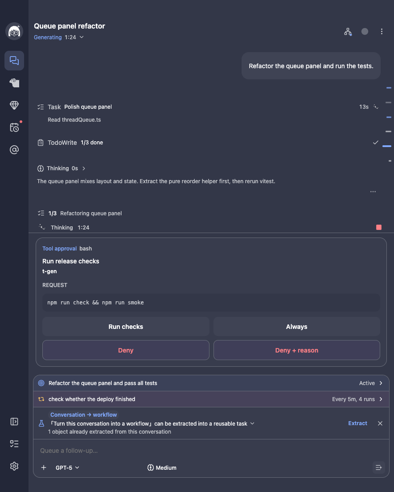 |
| Unfolded, 简体中文                                                                                 | Herdr, chat view                                                                                                           |
| 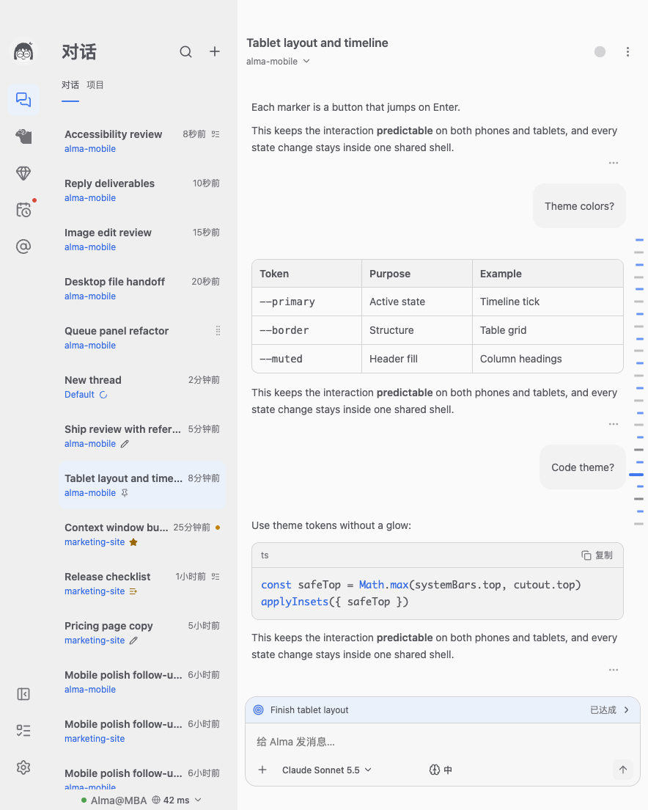                         | 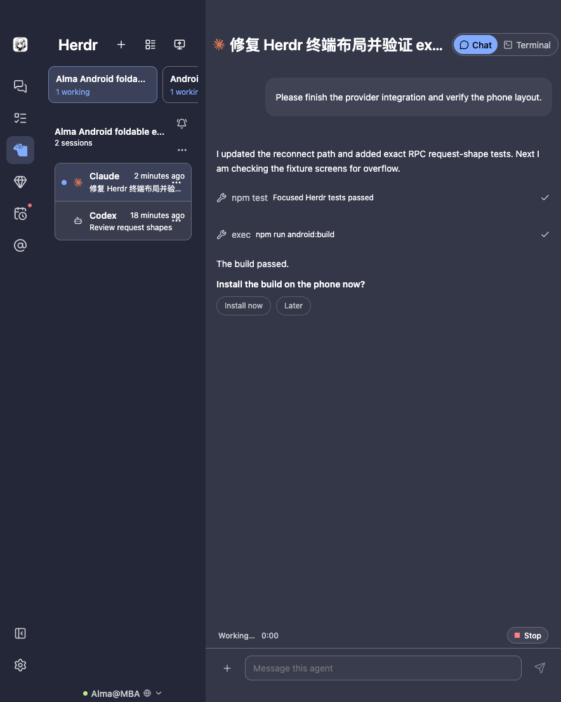                                         |
| Herdr, terminal with scrollback                                                                    |                                                                                                                            |
| 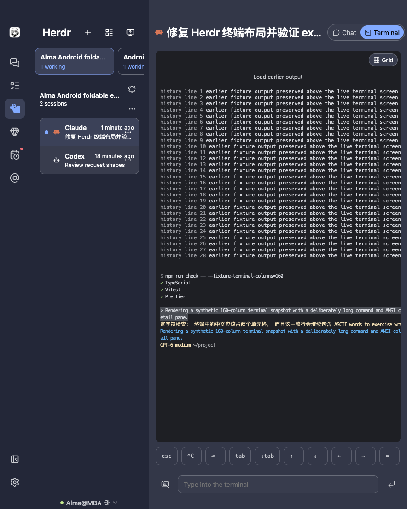 |                                                                                                                            |

Screenshots use synthetic fixture data and contain no real desktop content or pairing credentials. They show the official Alma mascot art, © yetone / Alma (see [Third-party assets](#third-party-assets)). Regenerate them with `npm run screenshots -- docs/screenshots readme`.

## Install

1. Download the APK and matching `.sha256` file from [GitHub Releases](https://github.com/lazyeo/alma-android/releases).
2. Verify the download:

   ```sh
   shasum -a 256 -c alma-android-vX.Y.Z.apk.sha256
   ```

3. Allow installation from your browser or file manager when Android asks, then open the APK.

The package name is `club.a_dobe.alma`. Settings › Updates can check, verify, and install newer public releases in app.

## Pair with Alma Desktop

1. In Alma Desktop, open remote access and display its pairing link or QR code.
2. In Alma Android, scan the QR code or paste the pairing link.
3. Repeat to add another desktop. On phones, tap the desktop name in the Threads or Herdr title to switch; on tablets and unfolded phones the switcher sits at the foot of the thread list.

The pairing link grants full access to that desktop. Treat it like a password: do not share it, paste it into an issue, or include it in logs.

The app connects through Alma's official relay and, when the phone and desktop share a local network, switches to a direct LAN connection that uses the same end-to-end handshake (falling back to the relay automatically). The inner tunnel is end-to-end encrypted between your Android device and desktop. This app does not store your conversations or pairing data on a third-party server; pairing information and limited UI caches stay on your device, while conversation data comes from your desktop.

## Features

- **Alma, your personal agent:** on Alma desktop 0.4.407+, Alma's face sits in the middle of the tab bar (and in the rail's top corner on wide screens). She opens as her own messenger-style conversation, with a status line for what she is doing, and while she works a small thought bubble now and then shows an emoji for her current step. Her face uses the official Alma mascot art wearing this app's glasses, with a vector face as the fallback.
- **Floating tab bar:** on phones a capsule with Threads, Alma and Herdr; GTD and Settings are icon buttons in the Threads header, and the current desktop's name in the page title opens the desktop switcher.
- Threads, projects (with project cards and Recent threads), and GTD views
- Streaming replies, tool calls, approvals, and user questions
- Long-press a message for a reduced preview card above its actions; retry a reply or resend a failed message from there
- Composer controls for model, reasoning effort, goals, and loops
- Thread file panel with diffs, plus HTML and Markdown previews
- Rich previews: KaTeX math, Mermaid diagrams, audio and video, PDF, CSV/XLSX and DOCX
- Code-block copy, Android Share-to-Alma, and an image gallery
- **Herdr coding agents:** for desktops running Herdr, board and list views of workspaces and sessions. Each session has a Chat view drawn with the same message components as threads, and a Terminal view with Fit/Grid layouts, on-demand scrollback and virtual keys. Answer an agent's permission menu from the chat or the session list, use slash commands, follow subagents, mute noisy workspaces, and get an "Agent needs you" alert.
- **Remote desktop:** watch a paired desktop's screen and control it as a trackpad (tap to click, hold then move to drag, two fingers to scroll or right-click), type text, and wake a sleeping display. Pinch to zoom 1–4x or switch between Fit and 1:1, pan with one finger, and on macOS pick another display or a single app window to stream.
- **LAN direct:** on the same Wi-Fi the app talks to the desktop directly instead of through the relay; the switcher shows a Wi-Fi icon for LAN or a globe for the relay.
- Multiple desktops with macOS, Windows or Linux icons and live latency
- Desktop Base46 theme palettes
- English and 简体中文, following the system language with a user override
- Foldable layouts and a frosted screen-transition effect; optional live hinge angle through Shizuku, with estimation as the fallback
- Local alerts when a reply finishes or an approval needs attention, and an optional foreground service that keeps connections alive in the background
- **In-app updates:** check GitHub Releases, read the notes, and install a SHA-256-verified APK without leaving the app

### Notification limitation

There is no push service. Notifications are generated locally from the live relay connection and work only while the app process is alive. Turn on Settings › Keep connected in background to hold the connection with a foreground service (it shows an ongoing notification). Android may still stop delivery after the app is killed, force-stopped, frozen, or disconnected.

## Privacy and security

- Pairing uses Alma Desktop's remote-access link and an end-to-end encrypted relay tunnel.
- The relay routes encrypted traffic; the app does not upload conversation history to its own backend.
- Multiple desktops are isolated by pairing.
- The pairing link is a full-access secret. See [SECURITY.md](SECURITY.md) before sharing diagnostics or reporting a vulnerability.
- The client intentionally blocks known dangerous desktop routes that it does not need.

The contributor-facing protocol notes are in [docs/protocol.md](docs/protocol.md).

## Build from source

Requirements:

- Node.js 22
- JDK 21
- Android SDK with API 36 installed (`minSdk 24`, `targetSdk 36`)

```sh
npm ci
npm run check
npm run android:build
```

The debug APK is written under `android/app/build/outputs/apk/debug/`.

For a release build, run `npm run android:release`. It is signed only when all four variables are set: `ALMA_RELEASE_STORE_FILE`, `ALMA_RELEASE_STORE_PASSWORD`, `ALMA_RELEASE_KEY_ALIAS`, and `ALMA_RELEASE_KEY_PASSWORD`.

`npm run build` (and so `android:build` and `android:release`) first runs `npm run mascot`, which downloads the official Alma Android release over HTTPS, checks its pinned SHA-256, caches it under `~/.cache/alma-mobile` and bundles the Alma artwork from it into `public/alma-mascot/` (gitignored, never committed). It needs `unzip`, and `sips` (macOS) or ImageMagick to downscale the art; without either the art stays full size. Environment variables:

- `ALMA_MASCOT=skip` skips the download and builds with the vector face (CI debug builds do this; `scripts/release.mjs` refuses it).
- `ALMA_MASCOT_MAX_SIDE` sets the longer side of the bundled art in pixels (default `512`, `0` keeps full size).
- `ALMA_MASCOT_CACHE` changes where the verified APK is cached.

The generated page metadata records `alma-build` as `<version> <sha>`, and Settings › About shows the version.

## Contributing

See [CONTRIBUTING.md](CONTRIBUTING.md). By participating, you agree to follow the repository's contribution and security guidance.

## Third-party assets

- The Alma mascot artwork is © yetone / Alma, is not covered by this repository's MIT licence, and is downloaded from the official Alma Android release at build time. This is an unofficial client. See [NOTICE.md](NOTICE.md).
- The [Herdr](https://github.com/herdrdev/herdr) logo is from Herdr's `assets/logo.svg` and is used under the [Apache License 2.0](https://github.com/herdrdev/herdr/blob/main/LICENSE). The Herdr trademark belongs to the Herdr project.
- The Claude Code mark is from [simple-icons 16.36.0](https://github.com/simple-icons/simple-icons/tree/16.36.0) and is used under [CC0-1.0](https://creativecommons.org/publicdomain/zero/1.0/). Claude Code is a trademark of Anthropic.
- The Codex mark is an original vector drawing of the Codex product icon. Codex is a trademark of OpenAI.
- The [pi](https://pi.dev/) mark's paths were taken from Alma Desktop's bundle. See pi's [official press kit](https://pi.dev/press-kit).

## License

[MIT](LICENSE) © 2026 lazyeo and contributors.
