# Alma Android

[简体中文](README.zh-CN.md)

> 🛠️ **Built with Alma, end to end.** This whole project is developed and managed through [Alma](https://alma.now): planning, code, tests, screenshots, releases and this README were produced by Alma and its agent crew, while a human steers and tests on real devices. An Alma client, made by Alma.

An unofficial Android client for [Alma Desktop](https://alma.now). Pair it with one or more desktops and keep working with your threads from an Android phone or foldable.

> **Disclaimer:** This project is not affiliated with, endorsed by, or maintained by the Alma project.

## Screenshots

| Threads                                                             | Conversation                                                        |
| ------------------------------------------------------------------- | ------------------------------------------------------------------- |
| 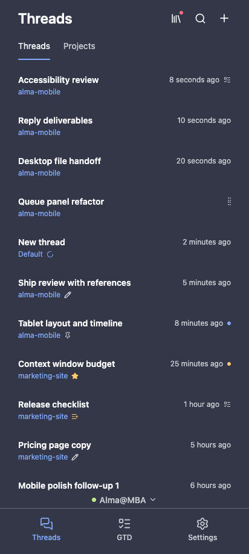                       | 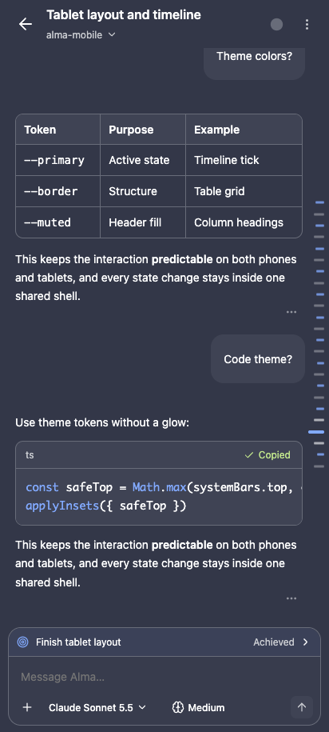 |
| Settings (简体中文)                                                 | Files and diffs                                                     |
| 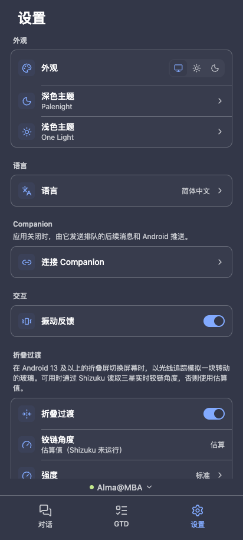 | 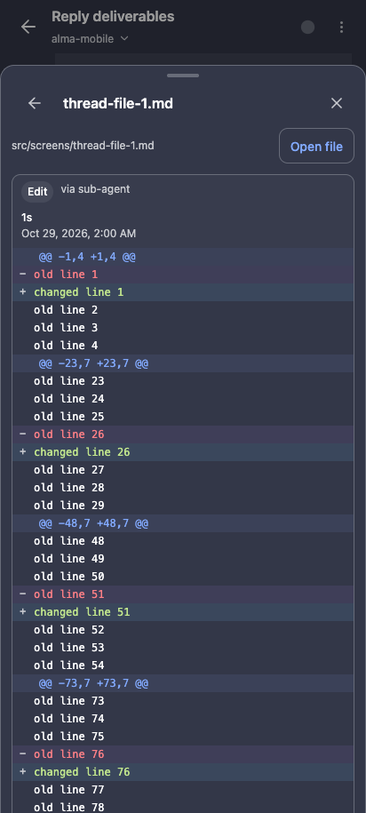           |

### Herdr agents, Mac screen and updates

| Herdr sessions                                                              | Answer an agent's menu                                                        |
| --------------------------------------------------------------------------- | ----------------------------------------------------------------------------- |
| 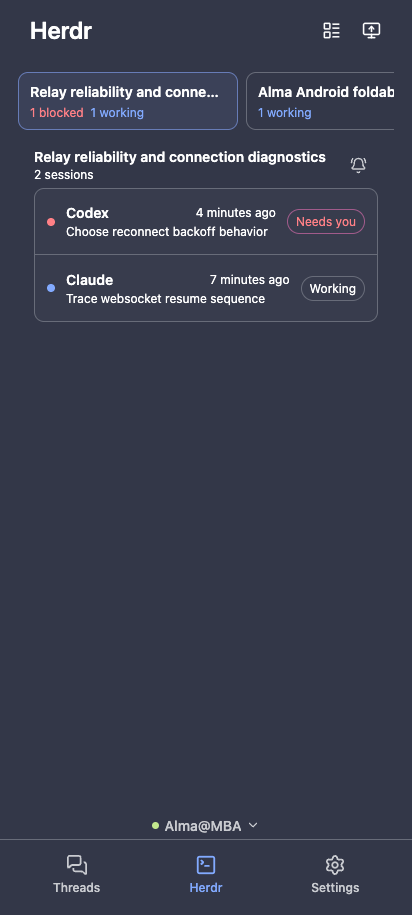 | 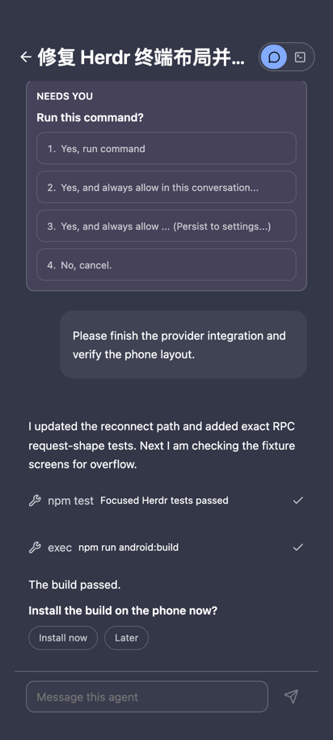 |
| Mac screen                                                                  | In-app updates                                                                |
| 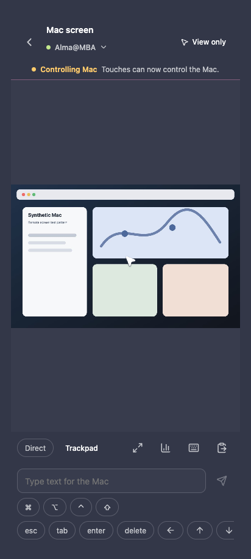              | 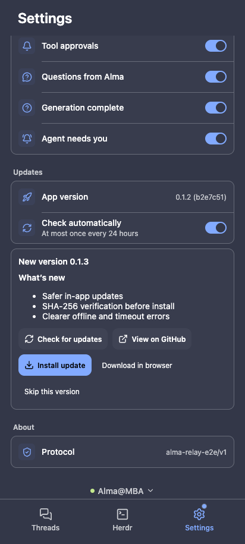              |

### Foldables

Unfolded, the app switches to a two-pane layout with a navigation rail, the thread list and the open conversation side by side. Folding and unfolding plays a frosted transition between the cover and inner screens.

| Unfolded, reply in progress                                                           | Unfolded, 简体中文                                                                                 |
| ------------------------------------------------------------------------------------- | -------------------------------------------------------------------------------------------------- |
| 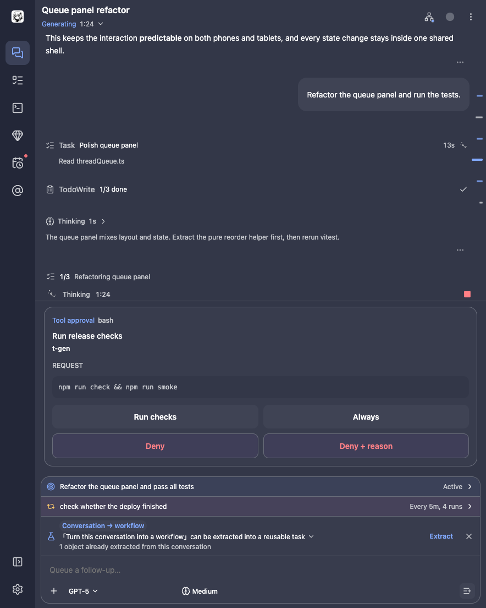 | 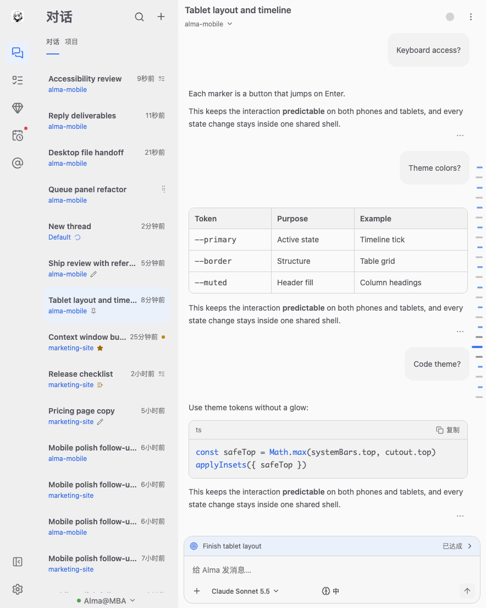                         |
| Herdr, chat view                                                                      | Herdr, terminal with scrollback                                                                    |
| 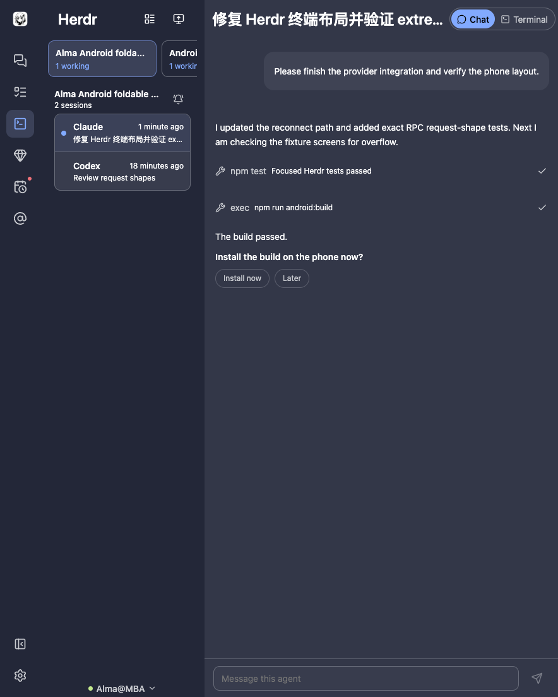    | 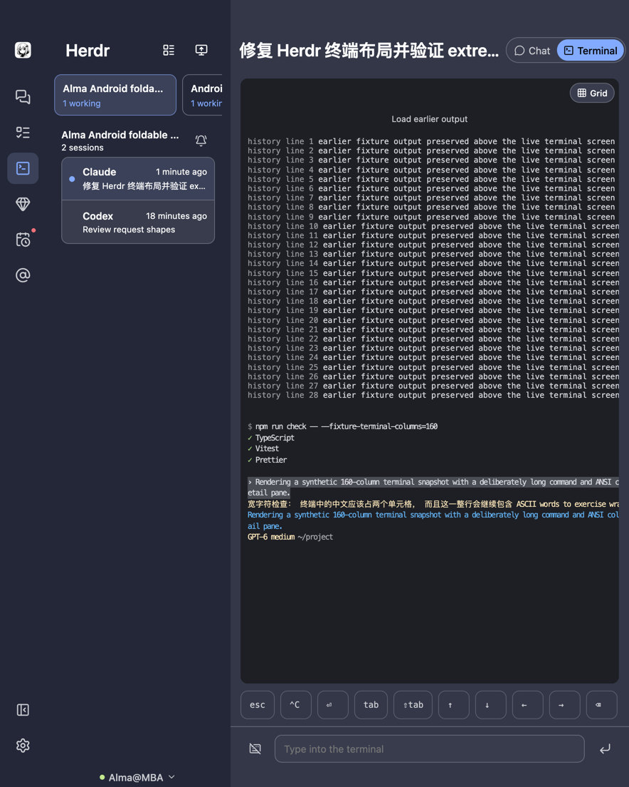 |

Screenshots use synthetic fixture data and contain no real desktop content or pairing credentials.

## Install

1. Download the APK and matching `.sha256` file from [GitHub Releases](https://github.com/lazyeo/alma-android/releases).
2. Verify the download:

   ```sh
   shasum -a 256 -c alma-android-vX.Y.Z.apk.sha256
   ```

3. Allow installation from your browser or file manager when Android asks, then open the APK.

The package name is `club.a_dobe.alma`. Settings › Updates can check, verify, and install newer public releases in app.

## Pair with Alma Desktop

1. In Alma Desktop, open remote access and display its pairing link or QR code.
2. In Alma Android, scan the QR code or paste the pairing link.
3. Repeat to add another desktop; use the desktop switcher to move between them.

The pairing link grants full access to that desktop. Treat it like a password: do not share it, paste it into an issue, or include it in logs.

The app connects through Alma's official relay. The inner tunnel is end-to-end encrypted between your Android device and desktop. This app does not store your conversations or pairing data on a third-party server; pairing information and limited UI caches stay on your device, while conversation data comes from your desktop.

## Features

- Threads, projects, and GTD views
- Streaming replies, tool calls, approvals, and user questions
- Composer controls for model, reasoning effort, goals, and loops
- Thread file panel with diffs, plus HTML and Markdown previews
- Code-block copy, Android Share-to-Alma, and an image gallery
- Desktop Base46 theme palettes
- English and 简体中文, following the system language with a user override
- Foldable layouts and a frosted screen-transition effect; optional live hinge angle through Shizuku, with estimation as the fallback
- Local alerts when a reply finishes or an approval needs attention
- **New in 0.1.3 — Herdr coding agents:** for desktops running Herdr, a Herdr tab with board and list views of workspaces and sessions. Each session has a Chat view drawn with the same message components as threads, and a Terminal view with Fit/Grid layouts, on-demand scrollback, virtual keys you can hide, and Enter-to-terminal input. Answer an agent's permission menu from the chat or straight from the session list, mute noisy workspaces, and get an "Agent needs you" alert.
- **New in 0.1.3 — Mac screen:** watch a paired desktop's screen, take control with direct touch or trackpad mode, type or paste text, switch desktops, and wake a sleeping display.
- **New in 0.1.3 — In-app updates:** check GitHub Releases, read the notes, and install a SHA-256-verified APK without leaving the app.
- **New in 0.1.3 — Background connection:** an optional foreground service keeps desktop connections and local alerts alive while the app is in the background.
- Rich previews: KaTeX math, Mermaid diagrams, audio and video, PDF, CSV/XLSX and DOCX

### Notification limitation

There is no push service. Notifications are generated locally from the live relay connection and work only while the app process is alive. Turn on Settings › Keep connected in background to hold the connection with a foreground service (it shows an ongoing notification). Android may still stop delivery after the app is killed, force-stopped, frozen, or disconnected.

## Privacy and security

- Pairing uses Alma Desktop's remote-access link and an end-to-end encrypted relay tunnel.
- The relay routes encrypted traffic; the app does not upload conversation history to its own backend.
- Multiple desktops are isolated by pairing.
- The pairing link is a full-access secret. See [SECURITY.md](SECURITY.md) before sharing diagnostics or reporting a vulnerability.
- The client intentionally blocks known dangerous desktop routes that it does not need.

The contributor-facing protocol notes are in [docs/protocol.md](docs/protocol.md).

## Build from source

Requirements:

- Node.js 22
- JDK 21
- Android SDK with API 36 installed (`minSdk 24`, `targetSdk 36`)

```sh
npm ci
npm run check
npm run android:build
```

The debug APK is written under `android/app/build/outputs/apk/debug/`.

For a release build, run `npm run android:release`. It is signed only when all four variables are set: `ALMA_RELEASE_STORE_FILE`, `ALMA_RELEASE_STORE_PASSWORD`, `ALMA_RELEASE_KEY_ALIAS`, and `ALMA_RELEASE_KEY_PASSWORD`.

The generated page metadata records `alma-build` as `<version> <sha>`, and Settings › About shows the version.

## Contributing

See [CONTRIBUTING.md](CONTRIBUTING.md). By participating, you agree to follow the repository's contribution and security guidance.

## License

[MIT](LICENSE) © 2026 lazyeo and contributors.
